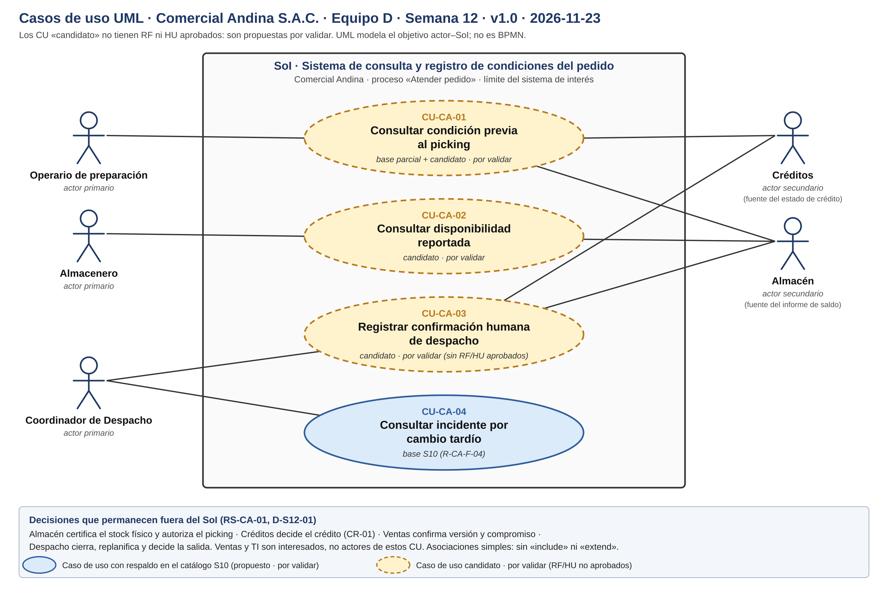

# Casos de uso UML · Fichas de casos de uso

Comercial Andina S.A.C. · Equipo D · Ingeniería de Requisitos (SI322) · 2026-II · Semana 12 · v1.0 · 2026-11-23

> **Advertencia metodológica.** Los pedidos P-2101…P-2106 y los datos D-S11 y D-S12 son supuestos académicos, no evidencia E33–E42. Ningún requisito, historia o criterio candidato está aprobado. Los escenarios están «diseñado, no ejecutado».

Este archivo es la copia en Markdown (para `git diff`) del Word `S12_EquipoD_Comercial_Andina_Fichas_CU_v1.0.docx`.

## 1. Contexto y frontera del SoI

KPI heredado: 144 de 200 entregas en ventana = 72 %; meta didáctica ≥ 95 % (190 de 200); brecha descriptiva de 46. No se atribuye causalidad a ningún caso de uso.

El SoI consulta, contrasta, presenta y registra condiciones documentadas del pedido (versión, crédito, saldo reportado, ruta). Las decisiones siguen en sus responsables: Almacén certifica el stock físico y autoriza el picking, Créditos decide el crédito (CR-01), Ventas confirma versión y compromiso, Despacho cierra, replanifica y decide la salida (RS-CA-01, D-S12-01).

«SUFICIENTE», «INSUFICIENTE», «NO VERIFICADO», «PENDIENTE DE DECISIÓN HUMANA» y «REGISTRO RECHAZADO» son los estados de salida ilustrativos de D-S12-07.

## 2. Casos de uso del diagrama

| CU | Nombre | Actor primario | Estado | HU de origen | Ficha |
|---|---|---|---|---|---|
| CU-CA-01 | Consultar condición previa al picking | Operario de preparación | Base parcial + candidato · por validar | HU-CA-01 | Breve |
| CU-CA-02 | Consultar disponibilidad reportada | Almacenero | Candidato · por validar | HU-CA-02 | Detallada |
| CU-CA-03 | Registrar confirmación humana de despacho | Coordinador de Despacho | Candidato · por validar (sin RF ni HU aprobados) | HU-CA-CAND-S12-01 | Detallada |
| CU-CA-04 | Consultar incidente por cambio tardío | Coordinador de Despacho | Base S10 (propuesto · por validar) | HU-CA-05 | Breve |

## 3. Ficha CU-CA-02 · Consultar disponibilidad reportada

### Datos generales

| Campo | Especificación |
|---|---|
| ID, título, versión | CU-CA-02 · Consultar disponibilidad reportada · v1.0 · 2026-11-23 |
| Estado | Candidato · por validar |
| Responsable | Equipo D (asignar nombre) |
| Objetivo y límites | Conocer la disponibilidad informada frente a la cantidad requerida del pedido y su versión, con fuente y vigencia, para detectar faltantes antes de que Ventas confirme disponibilidad. |
| Actor primario | Almacenero |
| Actores secundarios | Almacén (fuente del informe) |
| Interesados | Ventas (usa el resultado antes de confirmar disponibilidad; BR-CA-04), Almacén (certifica el stock físico), TI (factibilidad de IF-01). |
| Disparador | El almacenero solicita consultar la disponibilidad reportada de un pedido y versión (ej.: P-2101/V2). |
| Precondiciones | Pedido y versión identificados; usuario con rol vigente (por validar, Q-CA-S11-11); existe o se solicita una lectura de una fuente autorizada (R-CA-IF-01). |
| Garantías mínimas | El SoI nunca presenta como favorable un dato sin fuente, sin versión o desactualizado (D-S12-04) y nunca reserva ni certifica stock. |

### Origen trazable

| Campo | Especificación |
|---|---|
| Necesidad(es) N-CA | N-CA-02 — Conocer existencias realmente utilizables y separaciones pendientes antes de comprometer disponibilidad |
| Evidencia | E33 (19/200 diferencia de stock o sustitución), E35, E36, E41 |
| Brecha y BPMN TO-BE | G-CA-N-02, G-CA-D-01, G-CA-A-01 · Task_VerificarStock, Gateway_Stock, Task_PrepararPedido |
| HU | HU-CA-02 — Visualizar la disponibilidad reportada para la versión del pedido Estado: Borrador · Must |
| RF S10 | R-CA-F-03 — Consultar disponibilidad utilizable y separaciones antes de confirmar el compromiso R-CA-F-02 — Consultar versión y estado vigentes del pedido R-CA-F-04 — Advertir los cambios que invalidan verificaciones previas |
| RNF S10 | R-CA-Q-01 — Control de acceso al registro de la habilitación |
| Otros requisitos S10 | R-CA-IF-01 — Informe de Almacén hacia el SoI BR-CA-04 — Promesa preliminar frente a compromiso confirmado RS-CA-01 — El SoI no adquiere autoridad de decisión RS-CA-02 — No se asumen APIs ni integraciones existentes |
| Candidatos (no aprobados) | R-CA-F-CAND-S11-02 — Mostrar a Almacén, por ítem, cantidad requerida, saldo utilizable reportado y suficiencia o diferencia, con fuente y vigencia |
| HUAC principales | HUAC-CA-03 — Normal · P-2101/V2: «SUFICIENTE (14/12)»; no reserva stock HUAC-CA-04 — Negativo · P-2103/V1: «INSUFICIENTE: faltan 7»; decisión humana de Almacén y Ventas HUAC-CA-11 — Excepción · P-2104 V2→V3: «INFORME DE VERSIÓN ANTERIOR (V2)» |
| HUAC relacionados | HUAC-CA-05 — Cambio de versión · P-2104 V2→V3: verificaciones de V2 «SIN VIGENCIA» HUAC-CA-06 — Excepción · P-2106/V1: «NO VERIFICADO» con datos faltantes; sin «APTO» |
| AC-CA de S10 | AC-CA-03 — Disponibilidad por ítem con diferencia reportada (R-CA-F-03) AC-CA-04 — Verificaciones previas «sin vigencia» y aviso registrado (R-CA-F-04) AC-CA-IF-01 — Informe de Almacén con correlación y vigencia (R-CA-IF-01) AC-CA-RS-01 — No existe operación para decidir crédito, stock o rutas (RS-CA-01) |

### Flujo principal

**Flujo principal — Saldo suficiente · P-2101/V2**

Condición: P-2101/V2 requiere 12 unidades; Almacén informa 14 utilizables referidas a V2, con fuente y fecha-hora vigentes; ruta ABIERTA.

| Paso | Quién | Acción o respuesta observable |
|---|---|---|
| 1 | Almacenero | Solicita la disponibilidad reportada de P-2101, versión V2. |
| 2 | SoI | Verifica que el usuario tiene un rol vigente reconocido (R-CA-Q-01) y que el pedido y la versión existen. |
| 3 | SoI | Obtiene la cantidad requerida (12) y el último informe de Almacén para ese pedido y versión (saldo utilizable reportado: 14) con su fuente y fecha-hora (R-CA-IF-01; mecanismo por validar con TI, RS-CA-02). |
| 4 | SoI | Comprueba que el ID, la versión, la fuente, la fecha-hora y la vigencia del informe están presentes y corresponden a V2 (plazo de vigencia por definir, Q-CA-S11-16). |
| 5 | SoI | Compara el saldo reportado (14) con lo requerido (12) sin certificar ni reservar stock físico. |
| 6 | SoI | Presenta «SUFICIENTE (14/12), diferencia +2» con fuente, versión V2, fecha-hora del informe, hora de consulta y la advertencia de que la confirmación del stock físico corresponde a Almacén. |
| 7 | Almacenero | Revisa el resultado; si corresponde, certifica el stock físico fuera del SoI. |

- **Resultado:** Resultado «SUFICIENTE» visible con su origen; ninguna reserva ni descuento.
- **Cómo termina o se reanuda:** Fin del CU.
- **Escenario:** ES-CA-12-01 (diseñado, no ejecutado) · **HUAC:** HUAC-CA-03

### Flujos alternos y excepciones

**A1 · Alterno — Saldo insuficiente · P-2103/V1**

Punto de desvío: Paso 5 (comparación)

Condición: P-2103/V1 requiere 20 unidades y Almacén informa 13 utilizables referidas a V1.

| Paso | Quién | Acción o respuesta observable |
|---|---|---|
| A1.1 | SoI | Calcula la diferencia entre lo requerido (20) y lo reportado (13): 7 unidades. |
| A1.2 | SoI | Presenta «INSUFICIENTE: faltan 7» con fuente y hora, y deja el caso en «PENDIENTE DE DECISIÓN HUMANA» indicando que decide Almacén y renegocia Ventas. |
| A1.3 | SoI | No reserva stock, no propone ni registra una sustitución, no cambia la cantidad del pedido y no autoriza el picking. |
| A1.4 | Almacenero | Toma el resultado y gestiona la diferencia con Almacén y Ventas fuera del SoI. |

- **Resultado:** Faltante comunicado; decisión humana de Almacén y Ventas.
- **Cómo termina o se reanuda:** Fin del CU.
- **Escenario:** ES-CA-12-02 (diseñado, no ejecutado) · **HUAC:** HUAC-CA-04

**A2 · Alterno — Nueva versión del pedido · P-2104 V2→V3**

Punto de desvío: Paso 4 (comprobación de versión)

Condición: P-2104 evaluado en V2 (8 requeridas); V3 requiere 11; el informe disponible muestra 9 unidades sin versión indicada (supuesto de HUAC-CA-11: referido a V2; H-S11-06).

| Paso | Quién | Acción o respuesta observable |
|---|---|---|
| A2.1 | SoI | Detecta que V3 reemplaza a V2 y que el informe disponible no está asociado a V3. |
| A2.2 | SoI | Presenta «INFORME DE VERSIÓN ANTERIOR (V2)» con las 9 unidades, señala V3 como versión vigente (requiere 11) y no usa V2 como sustento: no calcula suficiencia ni diferencia para V3. |
| A2.3 | SoI | Solicita la revalidación de Almacén (no la ejecuta). |
| A2.4 | Almacén (fuente) | Emite un informe referido a V3. |

- **Resultado:** Evaluación de V2 no reutilizada; revalidación solicitada. Variante A2b: si Almacén confirma que las 9 unidades corresponden a V3 y están vigentes, el paso 5 muestra «INSUFICIENTE: faltan 2» (guía §4.4; Q-CA-S11-09).
- **Cómo termina o se reanuda:** Se reanuda en el paso 3 cuando exista un informe para V3.
- **Escenario:** ES-CA-12-03 (diseñado, no ejecutado) · **HUAC:** HUAC-CA-11 (y HUAC-CA-05 para la invalidación de V2)

**E1 · Excepción — Fuente sin respuesta o dato sin versión · P-2106/V1**

Punto de desvío: Paso 3 (obtención) o paso 4 (comprobación)

Condición: La fuente no responde o el dato carece de ID, versión, fuente o fecha-hora (D-S12-04). Ejemplo: P-2106/V1 con stock NO VERIFICADO.

| Paso | Quién | Acción o respuesta observable |
|---|---|---|
| E1.1 | SoI | Presenta «NO VERIFICADO» y enumera los datos ausentes (por ejemplo, el informe de Almacén). |
| E1.2 | SoI | No muestra el último dato conocido como si estuviera vigente ni presenta el valor de Andina360 como utilizable (AC-CA-03, caso negativo). |
| E1.3 | SoI | No calcula suficiencia ni diferencia. |

- **Resultado:** Resultado «NO VERIFICADO»; no hay resultado favorable posible.
- **Cómo termina o se reanuda:** El Almacenero puede reintentar desde el paso 1 cuando la fuente responda.
- **Escenario:** ES-CA-12-08 (diseñado, no ejecutado) · **HUAC:** HUAC-CA-06 (consulta con datos ausentes) y AC-CA-03 (caso negativo)

### Postcondiciones, pendientes y pruebas

| Campo | Especificación |
|---|---|
| Postcondición de éxito | Resultado (SUFICIENTE o INSUFICIENTE) visible con fuente, versión, fecha-hora del informe y hora de consulta. El registro de la consulta queda por validar (Q-CA-S12-11). |
| Postcondición de fallo | «NO VERIFICADO» o «INFORME DE VERSIÓN ANTERIOR (V2)»; sin cálculo de suficiencia; revalidación solicitada a Almacén cuando aplica. |
| Qué NO cambia | Saldo y reservas de Almacén, cantidad y versión del pedido, autorización de picking, compromiso con el cliente. |
| Escenarios (diseñados) | ES-CA-12-01, ES-CA-12-02, ES-CA-12-03, ES-CA-12-08 · «diseñado, no ejecutado» |
| Responsable de validación | Almacén |
| Pendientes | Q-CA-S11-01, Q-CA-S11-08, Q-CA-S11-09, Q-CA-S11-16; Q-CA-S12-02, Q-CA-S12-11; H-S12-01. |

## 4. Ficha CU-CA-03 · Registrar confirmación humana de despacho

### Datos generales

| Campo | Especificación |
|---|---|
| ID, título, versión | CU-CA-03 · Registrar confirmación humana de despacho · v1.0 · 2026-11-23 |
| Estado | Candidato · por validar (sin RF ni HU aprobados) |
| Responsable | Equipo D (asignar nombre) |
| Objetivo y límites | Dejar evidencia de quién decidió confirmar un despacho, cuándo y con qué información consultada (versión, crédito, saldo reportado, ruta). El Coordinador decide; el SoI registra y controla el acceso. |
| Actor primario | Coordinador de Despacho |
| Actores secundarios | Almacén (fuente), Créditos (fuente) |
| Interesados | Ventas (comunica el compromiso), Créditos (conserva el crédito), Almacén (conserva el saldo), Gerencia, TI. |
| Disparador | El Coordinador de Despacho solicita registrar su confirmación humana de despacho de un pedido y versión (D-S12-05). No es una autorización automática. |
| Precondiciones | Pedido y versión identificados; usuario con rol vigente de Despacho (R-CA-Q-01, ampliación por validar); evidencia consultable (versión, crédito, saldo reportado, ruta). «Confirmar despacho» sin definir: salida física, asignación de ruta o registro de autorización (Q-CA-S12-01). |
| Garantías mínimas | El SoI registra la decisión de un humano identificado; no aprueba crédito, no despacha el pedido, no cierra ni reabre rutas. Un dato «NO VERIFICADO» nunca produce un registro favorable. |

### Origen trazable

| Campo | Especificación |
|---|---|
| Necesidad(es) N-CA | N-CA-03 — Saber si el pedido está aprobado, observado o bloqueado y quién autoriza excepciones antes de habilitar el despacho N-CA-04 — Recibir dirección, bultos, preparación y cambios completos antes del cierre de ruta y saber cuándo replanificar NC-S12-01 — (Candidata, por elicitar) Dejar evidencia de quién decidió el despacho, cuándo y con qué información |
| Evidencia | Contexto, no respaldo directo: E33 (13/200 rutas reabiertas; 11/200 direcciones corregidas), E34, E35, E38 (cierre cerca de 13:40), E41; D-S12-05 |
| Brecha y BPMN TO-BE | G-CA-N-03, G-CA-A-01 (contexto) · Gateway_Corte, Task_EnviarPedidoApto, Task_AsignarRuta (contexto) |
| HU | HU-CA-CAND-S12-01 — Registrar mi confirmación humana de despacho con la versión y condiciones consultadas Estado: Candidata S12 · no aprobada · fuera del backlog S11 |
| RF S10 | R-CA-F-01 — Registrar la versión del pedido que sustenta la habilitación para preparación R-CA-F-02 — Consultar versión y estado vigentes del pedido R-CA-F-04 — Advertir los cambios que invalidan verificaciones previas |
| RNF S10 | R-CA-Q-01 — Control de acceso al registro de la habilitación R-CA-Q-02 — Registros auditables e íntegros |
| Otros requisitos S10 | R-CA-IF-01 — Informe de Almacén hacia el SoI R-CA-IF-02 — Estado de crédito desde Créditos hacia el SoI R-CA-IF-03 — Pedido apto y cambios entre el SoI y Despacho R-CA-D-01 — Historial de versiones y cambios del pedido BR-CA-03 — Estabilidad del pedido antes del cierre de ruta RS-CA-01 — El SoI no adquiere autoridad de decisión |
| Candidatos (no aprobados) | R-CA-F-CAND-S12-01 — Registrar la confirmación humana de despacho del Coordinador con la evidencia consultada HU-CA-CAND-S12-01 — Registrar mi confirmación humana de despacho con la versión y condiciones consultadas |
| HUAC principales | HUAC-CA-CAND-S12-01 — Normal (candidato S12) · P-2101/V2: «CONFIRMACIÓN REGISTRADA» con autor, rol, hora y evidencia HUAC-CA-CAND-S12-02 — Negativo (candidato S12) · P-2105/V1: discrepancia al intentar confirmar con ruta cerrada HUAC-CA-CAND-S12-03 — Excepción (candidato S12) · P-2106/V1: «NO VERIFICADO»; confirmación no registrada HUAC-CA-CAND-S12-04 — Seguridad (candidato S12): usuario sin rol de Despacho; «ACCESO DENEGADO» auditado |
| HUAC relacionados | HUAC-CA-09 — Negativo · P-2105/V1: «DISCREPANCIA: cambio posterior al cierre» HUAC-CA-10 — Excepción · P-2105/V1: replanificación sin motivo → «motivo no informado» HUAC-CA-12 — Seguridad (RNF) · P-2101/V2: cuenta sin rol denegada y auditada HUAC-CA-06 — Excepción · P-2106/V1: «NO VERIFICADO» con datos faltantes; sin «APTO» |
| AC-CA de S10 | AC-CA-Q-01 — Solicitudes autorizadas con identidad y hora; rol sin permiso denegado y auditado (R-CA-Q-01) AC-CA-Q-02 — Registros con autor, hora, motivo y versión; sin edición silenciosa (R-CA-Q-02) AC-CA-IF-03 — Mensaje pedido apto y cambios con Despacho (R-CA-IF-03) AC-CA-RS-01 — No existe operación para decidir crédito, stock o rutas (RS-CA-01) AC-CA-04 — Verificaciones previas «sin vigencia» y aviso registrado (R-CA-F-04) AC-CA-01 — Aptitud para preparación registrada con ID y versión (R-CA-F-01) AC-CA-IF-01 — Informe de Almacén con correlación y vigencia (R-CA-IF-01) AC-CA-IF-02 — Estado de crédito desde Créditos (R-CA-IF-02) |

### Flujo principal

**Flujo principal — Confirmación con condiciones verificadas · P-2101/V2**

Condición: Coordinador de Despacho con rol vigente; P-2101/V2 con versión CONFIRMADA, crédito APROBADO, saldo reportado 14 frente a 12 y ruta ABIERTA, cada dato con fuente y fecha-hora.

| Paso | Quién | Acción o respuesta observable |
|---|---|---|
| 1 | Coordinador de Despacho | Solicita registrar su confirmación humana de despacho de P-2101, versión V2 (no es una autorización automática). |
| 2 | SoI | Verifica que el usuario tiene un rol vigente de Despacho (R-CA-Q-01, ampliación por validar) y que el pedido y la versión existen. |
| 3 | SoI | Presenta la evidencia consultada: V2 (CONFIRMADA), crédito APROBADO, saldo 14 frente a 12 y ruta ABIERTA, cada dato con fuente y fecha-hora, más la hora de consulta. |
| 4 | Coordinador de Despacho | Revisa la evidencia y declara su decisión de confirmar, con una observación opcional. |
| 5 | SoI | Comprueba que la versión sigue vigente, que no hay un cambio posterior al cierre de ruta y que ningún dato está «NO VERIFICADO». |
| 6 | SoI | Registra la confirmación humana con autor, rol, fecha-hora, pedido, versión y evidencia consultada, sin modificar crédito, stock ni ruta (R-CA-Q-02, RS-CA-01). |
| 7 | SoI | Muestra «CONFIRMACIÓN REGISTRADA» con el comprobante del registro. |

- **Resultado:** Existe un registro de quién confirmó, cuándo y con qué evidencia; ningún estado de crédito, stock o ruta cambió.
- **Cómo termina o se reanuda:** Fin del CU.
- **Escenario:** ES-CA-12-07 (diseñado, no ejecutado) · **HUAC:** HUAC-CA-CAND-S12-01 (candidato)

### Flujos alternos y excepciones

**A1 · Alterno — Ruta cerrada y cambio tardío · P-2105/V1**

Punto de desvío: Paso 5 (comprobación)

Condición: P-2105/V1 con ruta CERRADA a las 13:40 y cambio de dirección registrado a las 13:46; el Coordinador intenta confirmar la misma ruta.

| Paso | Quién | Acción o respuesta observable |
|---|---|---|
| A1.1 | SoI | Detecta que el cambio (13:46) es posterior al cierre de ruta (13:40) (R-CA-F-04, R-CA-IF-03). |
| A1.2 | SoI | Presenta «DISCREPANCIA: cambio posterior al cierre» con la versión, la hora de cierre, la hora del cambio y las direcciones anterior y nueva, y deja el caso en «PENDIENTE DE DECISIÓN HUMANA». |
| A1.3 | SoI | No reabre, cierra ni replanifica la ruta y no autoriza un nuevo despacho (RS-CA-01). Si el Coordinador mantiene su decisión, el SoI conserva visible la discrepancia en el registro (regla candidata; Q-CA-S12-07). |
| A1.4 | Coordinador de Despacho | Decide fuera del SoI si replanifica y, si lo hace, deja el motivo. |

- **Resultado:** Discrepancia advertida y evidencia conservada; la decisión sigue en Despacho.
- **Cómo termina o se reanuda:** Se reanuda desde el paso 1 con la versión o ruta resultante, o termina sin confirmación.
- **Escenario:** ES-CA-12-04 (diseñado, no ejecutado) · **HUAC:** HUAC-CA-CAND-S12-02 (candidato); HUAC-CA-09 (detección, existente)

**A2 · Alterno — Crédito y stock no verificados · P-2106/V1**

Punto de desvío: Paso 3 (evidencia con datos «NO VERIFICADO»)

Condición: P-2106/V1 con versión PRELIMINAR, crédito sin respuesta, stock NO VERIFICADO y ruta no confirmada.

| Paso | Quién | Acción o respuesta observable |
|---|---|---|
| A2.1 | SoI | Presenta «NO VERIFICADO» con la lista de datos faltantes (crédito, stock, ruta) y la versión PRELIMINAR, e indica quién debe aclarar cada uno: Créditos, Almacén, Despacho; Ventas confirma la versión. |
| A2.2 | SoI | No registra la confirmación: devuelve «REGISTRO RECHAZADO» o «PENDIENTE DE DECISIÓN HUMANA», según la regla que se acuerde (Q-CA-S12-08). No presume aprobación ni suficiencia. |
| A2.3 | Coordinador de Despacho | Espera los aportes de los responsables; no se registra confirmación mientras falten datos. |

- **Resultado:** Sin registro de confirmación; faltantes y responsables visibles.
- **Cómo termina o se reanuda:** Se reanuda desde el paso 1 cuando los datos estén informados.
- **Escenario:** ES-CA-12-05 (diseñado, no ejecutado) · **HUAC:** HUAC-CA-CAND-S12-03 (candidato); HUAC-CA-06 (consulta, existente)

**E1 · Excepción — Usuario sin rol de Despacho**

Punto de desvío: Paso 2 (verificación de rol)

Condición: Un usuario sin rol de Despacho vigente solicita la operación protegida (D-S12-06).

| Paso | Quién | Acción o respuesta observable |
|---|---|---|
| E1.1 | SoI | Deniega la solicitud con «ACCESO DENEGADO»; no presenta evidencia protegida ni registra confirmación. |
| E1.2 | SoI | Audita el intento: usuario, hora, operación y resultado (AC-CA-Q-01). |

- **Resultado:** Ninguna confirmación registrada; intento auditado. Propuesta sujeta al RNF de rol.
- **Cómo termina o se reanuda:** Fin del CU.
- **Escenario:** ES-CA-12-06 (diseñado, no ejecutado) · **HUAC:** HUAC-CA-CAND-S12-04 (candidato); HUAC-CA-12 (R-CA-Q-01, otra operación)

### Postcondiciones, pendientes y pruebas

| Campo | Especificación |
|---|---|
| Postcondición de éxito | Registro de la confirmación con autor, rol, fecha-hora, versión y evidencia; no editable sin una nueva entrada correctora enlazada (R-CA-Q-02). |
| Postcondición de fallo | Sin registro de confirmación; discrepancias o faltantes visibles; intento auditado cuando hay acceso denegado. |
| Qué NO cambia | Estado de crédito (Créditos), saldo y reservas (Almacén), cierre o replanificación de la ruta y salida física (Despacho), compromiso con el cliente (Ventas). |
| Escenarios (diseñados) | ES-CA-12-04, ES-CA-12-05, ES-CA-12-06, ES-CA-12-07 · «diseñado, no ejecutado» |
| Responsable de validación | Despacho (con Ventas, Créditos, Almacén y TI) |
| Pendientes | Q-CA-S12-01, Q-CA-S12-07, Q-CA-S12-08, Q-CA-S12-09; H-S12-02, H-S12-03; HU-CA-05 solo aporta contexto de cambios de ruta. |

## 5. Fichas breves de CU-CA-01 y CU-CA-04

Flujo principal y una variante; los alternos y excepciones restantes se completan en S13.

### CU-CA-01 · Consultar condición previa al picking

| Campo | Especificación |
|---|---|
| Estado | Base parcial + candidato · por validar |
| Actor primario / secundarios | Operario de preparación / Almacén (fuente), Créditos (fuente) |
| Objetivo | Conocer, antes de iniciar el picking, si el pedido y su versión tienen condiciones registradas y vigentes (crédito, saldo reportado, ruta). |
| Disparador y precondición | El operario solicita las condiciones previas de un pedido y versión antes de iniciar el picking. El pedido y la versión están identificados; el usuario tiene rol vigente (por validar). |
| Origen | HU-CA-01 — Consultar las condiciones registradas antes de iniciar el picking R-CA-F-01 — Registrar la versión del pedido que sustenta la habilitación para preparación R-CA-F-02 — Consultar versión y estado vigentes del pedido R-CA-F-CAND-S11-01 — Mostrar al personal de preparación la condición de aptitud («APTO», «NO APTO» con motivo, «NO VERIFICADO») sin autorizar el picking |
| HUAC y escenarios | HUAC-CA-01, HUAC-CA-02, HUAC-CA-12 · ES-CA-12-09, ES-CA-12-10 |

**Flujo principal — Condiciones favorables · P-2101/V2**

Condición: P-2101/V2 con versión CONFIRMADA, crédito APROBADO, 14 unidades informadas para 12 requeridas y ruta ABIERTA, cada dato con fuente y fecha-hora.

| Paso | Quién | Acción o respuesta observable |
|---|---|---|
| 1 | Operario de preparación | Solicita las condiciones previas al picking de P-2101, versión V2. |
| 2 | SoI | Verifica que el usuario tiene un rol vigente reconocido (R-CA-Q-01; el rol del operario está por validar, Q-CA-S11-11). |
| 3 | SoI | Obtiene la versión, el estado de crédito (R-CA-IF-02), el saldo reportado (R-CA-IF-01) y la ruta, con su fuente y fecha-hora. |
| 4 | SoI | Presenta V2, crédito APROBADO, saldo 14 frente a 12 y ruta ABIERTA, con fuente, fecha-hora y hora de consulta, y la leyenda «información reportada; el inicio del picking lo autoriza Almacén». No registra ninguna autorización de picking. |

- **Resultado:** Condiciones visibles con su origen; ninguna autorización generada.
- **Cómo termina o se reanuda:** Fin del CU.
- **Escenario:** ES-CA-12-09 (diseñado, no ejecutado) · **HUAC:** HUAC-CA-01

**A1 · Alterno — Crédito observado · P-2102/V1**

Punto de desvío: Paso 4

Condición: P-2102/V1 con crédito OBSERVADO (autor y motivo informados por Créditos) y 15 unidades informadas para 10 requeridas.

| Paso | Quién | Acción o respuesta observable |
|---|---|---|
| A1.1 | SoI | En lugar de la presentación favorable, muestra «NO APTO · CRÉDITO OBSERVADO» con fuente y fecha-hora del estado de crédito y la indicación de que decide Créditos. |
| A1.2 | SoI | No marca el picking como autorizado aunque el saldo reportado sea suficiente (15 frente a 10). |

- **Resultado:** Señal informativa «NO APTO» (BR-CA-01); decisión de Créditos intacta. Etiqueta pendiente de validar (H-S11-03).
- **Cómo termina o se reanuda:** Fin del CU.
- **Escenario:** ES-CA-12-10 (diseñado, no ejecutado) · **HUAC:** HUAC-CA-02

| Campo | Especificación |
|---|---|
| Postcondiciones | Condiciones visibles con su origen y la hora de consulta. Se muestra «NO APTO» o «NO VERIFICADO»; el picking nunca queda autorizado por el SoI. |
| Qué NO cambia | Autorización de picking (Almacén), estado de crédito (Créditos), versión (Ventas). |
| Pendientes | Q-CA-S11-04, Q-CA-S11-05, Q-CA-S11-11; H-S11-03 («NO APTO» como señal informativa); H-S11-05 (rol del operario). |

### CU-CA-04 · Consultar incidente por cambio tardío

| Campo | Especificación |
|---|---|
| Estado | Base S10 (propuesto · por validar) |
| Actor primario / secundarios | Coordinador de Despacho / — |
| Objetivo | Identificar los cambios recibidos después del cierre de ruta (versión, hora de cierre, hora del cambio, direcciones) para decidir si replanifica. |
| Disparador y precondición | El coordinador consulta un pedido con cambios recibidos después del cierre de ruta. Pedido y versión identificados; cierre de ruta y cambio registrados con hora; usuario con rol vigente. |
| Origen | HU-CA-05 — Identificar cambios recibidos después del cierre de ruta R-CA-F-04 — Advertir los cambios que invalidan verificaciones previas |
| HUAC y escenarios | HUAC-CA-09, HUAC-CA-10 · ES-CA-12-11, ES-CA-12-12 |

**Flujo principal — Cambio posterior al cierre · P-2105/V1**

Condición: P-2105/V1 con ruta CERRADA a las 13:40 y cambio de dirección registrado a las 13:46.

| Paso | Quién | Acción o respuesta observable |
|---|---|---|
| 1 | Coordinador de Despacho | Consulta el pedido P-2105/V1. |
| 2 | SoI | Verifica que el usuario tiene un rol vigente reconocido (R-CA-Q-01). |
| 3 | SoI | Contrasta la hora de cierre de ruta (13:40) con la hora del cambio (13:46). |
| 4 | SoI | Presenta «DISCREPANCIA: cambio posterior al cierre» con la versión, ambas horas y las direcciones anterior y nueva, y solicita la decisión de Despacho. No reabre la ruta, no replanifica y no autoriza un nuevo despacho. |
| 5 | Coordinador de Despacho | Decide fuera del SoI si replanifica; si registra la replanificación, el SoI la conserva con autor, fecha-hora y motivo. |

- **Resultado:** Discrepancia visible con su evidencia; decisión de Despacho.
- **Cómo termina o se reanuda:** Fin del CU.
- **Escenario:** ES-CA-12-11 (diseñado, no ejecutado) · **HUAC:** HUAC-CA-09

**E1 · Excepción — Replanificación sin motivo**

Punto de desvío: Paso 5

Condición: Despacho registra una replanificación de P-2105 sin indicar el motivo.

| Paso | Quién | Acción o respuesta observable |
|---|---|---|
| E1.1 | SoI | Conserva la replanificación con la marca «motivo no informado», avisa a Despacho y conserva el registro original. |
| E1.2 | SoI | No rechaza ni revierte la decisión de Despacho. |

- **Resultado:** Registro conservado con marca; decisión intacta.
- **Cómo termina o se reanuda:** Fin del CU.
- **Escenario:** ES-CA-12-12 (diseñado, no ejecutado) · **HUAC:** HUAC-CA-10

| Campo | Especificación |
|---|---|
| Postcondiciones | Discrepancia visible con evidencia; decisión pendiente de Despacho. Replanificación conservada con «motivo no informado» cuando falta el motivo. |
| Qué NO cambia | Estado de la ruta y decisión de replanificación (Despacho). |
| Pendientes | Q-CA-S11-07, Q-CA-S11-14; R6 (vigencia del cierre 13:40–13:45); U-04; P-S10-06. Alternos pendientes de completar en S13. |

## 6. Límites y pendientes

- CU-CA-02 y CU-CA-03 son candidatos: faltan requisitos o historias aprobados (H-S12-01, H-S12-02).
- «Confirmar despacho» sigue sin definición (Q-CA-S12-01).
- El SoI muestra y registra; nunca decide.
- Preguntas, hallazgos y cambios: libro `S12_EquipoD_Comercial_Andina_Matrices_CU_v1.0.xlsx`.
